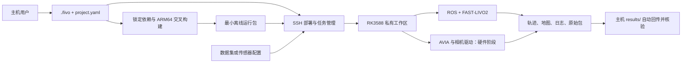

# AVIA + 单目相机 LIVO 平台计划

日期：2026-10-23（Asia/Shanghai）
状态：用户已批准实施；当前以远控基础功能和板端数据集回放为验收目标。接口与进度以 README 和下方实施记录为准。
目标目录：`/home/eric/grad/实验/livo2`，独立 Git；论文位于 `../../论文`。

## 1. 交付目标与使用原则

这是一套面向采集数据和开展硕士论文实验的工具。新用户只需找到一个入口、修改一份配置，即可从主机启动板端实验，并在主机收到结果。编译、ROS 环境、驱动、传输和进程管理由工具完成。

第一周优先交付：**现有 LiDAR + IMU + 单目图像数据集在 RK3588 上完成一次 FAST-LIVO2 回放；主机一条命令完成检查、必要构建、部署、数据上传、运行及结果回传。** 同时交付可独立安装的 ARM64 运行包。真实传感器的接线由用户处理，后续接入使用同一套运行和回传机制。

这是一个有验收条件的七日目标，不把未经验证的耗时或实时性写成保证。数据集跑通、真实硬件连通、标定有效和采集可用分别验收，不能相互替代。

设计约束：

- 主入口暂定 `./livo`，不要求用户手动激活 uv、source ROS、开多个终端或拼接 SSH 命令。
- 全部需要用户调整的参数集中于 `project.yaml`；内部生成的 YAML/launch 不作为编辑入口。
- 默认值覆盖日常操作；详细工程资料放在 PLAN，README 只保留快速上手。
- 本工程管理自己的依赖锁、构建目录和运行包。VINS 仅供接口和打包经验参考，不成为本工程的运行依赖。
- 第一版板端运行不要求联网、不要求预装完整 ROS，不在板端编译。
- 默认单板、单任务；不建设通用集群调度、Web 面板或复杂远控框架。

## 2. 已核查事实与尚未核查项

### 2.1 当前环境

| 项目 | 当前证据 | 设计影响 |
| --- | --- | --- |
| 主机 | Ubuntu 22.04.5，x86_64；PATH 有 uv、Docker、CMake | 可采用 uv 管理主机 CLI、隔离构建器管理 C++/ROS；Docker 服务及权限尚未验证 |
| 主机空间 | 本次检查约剩余 46 GiB | 下载前计算数据和构建峰值；不足时由统一配置切换缓存/数据位置 |
| ARM 交叉编译器 | 主机 PATH 未发现 `aarch64-linux-gnu-g++` | 由锁定构建器提供，不假设系统已有 |
| 板端 | 用户给定 firefly@10.106.0.220、Ubuntu 22.04、RK3588 | 作为目标配置；架构、glibc、内存、磁盘、权限仍需实查 |
| SSH | 2026-10-23 本次只读连接超时 | 实施第一步重新核验网络，不能归因于密码或直接判为板端故障 |
| 实验仓库 | 旧 GS-SDF 已按用户指令删除 | 从独立新工程开始 |
| 参考工程 | 指定参考分支存在；当前检出实际为 codex/rk3588-ros2 | 已用 git show 只读查看 codex/rk3588-ros1，未切分支、未修改 |

参考分支只抽取四点：私有运行前缀、版本目录部署、断线可恢复任务、结果校验。没有继承其完整远控协议或现有二进制。参考分支查看时的提交为 `d2be5d6f0f48a7bd25152537ba40125b2e712155`。

### 2.2 上游适配事实

- FAST-LIVO2 主线使用 ROS 1/catkin；其 README 给出的环境是 Ubuntu 18.04–20.04，需要 PCL、OpenCV、Eigen、旧版 Sophus 及指定 Vikit。AVIA 接口还涉及 `livox_ros_driver/CustomMsg`，数据集回放也必须构建并打包对应消息支持。[FAST-LIVO2](https://github.com/hku-mars/FAST-LIVO2)、[预处理接口](https://github.com/hku-mars/FAST-LIVO2/blob/main/include/preprocess.h)
- AVIA 选择第一代 Livox-SDK 与 livox_ros_driver。不能因驱动名带“2”就替换为当前面向 HAP/Mid-360 的 driver2。[SDK](https://github.com/Livox-SDK/Livox-SDK)、[AVIA 驱动](https://github.com/Livox-SDK/livox_ros_driver)、[driver2 支持范围](https://github.com/Livox-SDK/livox_ros_driver2)
- 无标定板外参标定首选 HKU-MARS `livox_camera_calib`，适合这次单 LiDAR + 单相机组合；`mlcc` 留作必要时评估的替代方案。标定可在主机离线运行，无需先塞入板端最小包。[livox_camera_calib](https://github.com/hku-mars/livox_camera_calib)、[mlcc](https://github.com/hku-mars/mlcc)
- ROS Noetic 已结束支持，因此依赖必须锁定并保存可校验缓存，构建不依赖“系统里碰巧装了某个 ROS”。这也是工程选择隔离前缀的原因。[ROS 官方公告](https://discourse.ros.org/t/ros-noetic-end-of-life-may-31-2025/43160)

上述网页在本轮已核查，尚未固定本工程的上游 SHA，也没有进行编译或板端验证。

## 3. 顶层架构与技术选择



### 3.1 主机环境：uv 与 C++ 构建器分工

`uv.lock` 管理 Python CLI、配置校验、数据检查、结果汇总和标定辅助工具。`./livo` 包装必要的 uv 调用；首次缺 uv 时给出明确的引导，提供可选的一次性安装途径，用户不需要手工维护虚拟环境。

ROS/C++、交叉编译器及目标 sysroot 由独立锁定构建器管理。首选主机 Docker 构建环境，固定镜像 digest、软件包版本、源码 SHA 与下载校验和。Docker 只承担主机构建，板端默认原生运行。uv 不承担管理 PCL、ROS ABI 或 ARM 共享库的职责。

依赖按来源区分：ROS 和通用系统库可使用锁定的发行版二进制包构建 sysroot；FAST-LIVO2、Sophus、Vikit、Livox SDK 与 ROS 驱动从工程管理的源码构建。相机厂商若只提供二进制 SDK，则锁定官方 ARM64 包并纳入运行依赖，不能承诺将闭源 SDK 源码编译。

### 3.2 板端运行：私有 ROS 1 前缀

首选方案为 ROS 1 Noetic/Focal ARM64 用户态依赖集，加本工程交叉构建的算法和库，打包至板端私有目录。板端仍使用 Ubuntu 22.04 系统及其 loader/glibc，ROS 使用包内私有 Python 解释器及 Python 模块。

Focal 用户态在 Jammy 上能否满足完整 ABI 与运行需求，要通过首个部署门槛证明；不能只凭旧 glibc 的兼容方向宣布成功。逐项检查动态库、GLIBC/GLIBCXX 版本、Python 扩展、包索引和图像插件。失败时先定位依赖闭包并在同一打包模型中修复，不直接给板端混装 Focal apt 软件源。若此路线确实不可行，再提交替代构建设计，不同时维护多套正式运行路线。

最小包包括 roscore/roslaunch/rosbag 等实际使用组件、消息类型、图像解码插件、FAST-LIVO2 及递归运行库；数据集和标定工具不混入基础运行包，RViz 留在主机。包大小由实际依赖闭包裁剪和报告，不提前承诺体积。

### 3.3 交叉编译必须处理的适配点

- CMake 明确设置目标 aarch64、sysroot、host/target 搜索边界；代码生成器在主机运行，不能误执行 ARM 程序。
- 上游构建中的 `native` CPU 参数与按构建机检测的并行度需改为目标显式设置；第一版采用可移植 ARMv8-A 基线，后续再做 RK3588 调优，不让主机 CPU 决定 ARM 指令。
- 上游存在编译期源码根路径，需最小补丁支持运行时输出目录，轨迹、PCD、图像不能写回主机源码路径。[构建文件](https://github.com/hku-mars/FAST-LIVO2/blob/main/CMakeLists.txt)、[运行代码](https://github.com/hku-mars/FAST-LIVO2/blob/main/src/LIVMapper.cpp)
- 产物必须是真正可移动的 install 包，处理 catkin/Python 启动器和路径重定位；更换解压路径后再验一次。
- 所有改动以独立 patch 和锁文件记录；先保留算法默认行为，只改构建、路径与必要生命周期问题。

### 3.4 SDK 和驱动在工程内的位置

第一版数据集模式没有真实驱动进程，但构建包含 AVIA 消息包，且为下一阶段保留 SDK/驱动构建链。第二阶段加入 Livox SDK、AVIA 驱动和选定相机适配器的可重复构建。

所有依赖保留工程内的获取配方、锁文件和缓存入口；下载内容不用全部提交普通 Git。`./livo build` 按选定功能构建，第一次下载后可从缓存重复构建。相机型号未确定时不预装多家 SDK；实时模式预检明确提示缺失项。

## 4. 用户接口：日常只需要四个动作

以下命令是待实现的验收接口，当前不可执行。

```bash
# 初次使用：只编辑这一份文件
$EDITOR project.yaml

# 数据集：自动检查、必要时构建和部署、上传数据、运行、回传
./livo run

# 进入已初始化环境的板端工作目录
./livo ssh

# 查看当前/最近一次任务的摘要、进度和重要告警，断线后可重新连接
./livo status --follow

# 正常停止当前任务，等待文件写完并自动回传
./livo stop
```

后续硬件模式只增加同一入口：`./livo run --live`。默认同时启动驱动、LIVO 和录包，停止后回传包括录包在内的结果。

维护动作保持短命令：

| 命令 | 用途 |
| --- | --- |
| `./livo doctor` | 检查主机、SSH、板端、配置、数据与空间，列出可操作的修复提示 |
| `./livo build` | 只准备依赖、交叉构建和生成运行包，不连接传感器 |
| `./livo deploy` | 只安装选定运行包、初始化本工程环境，不开始实验 |
| `./livo pull [run-id]` | 重新收取当前或指定任务；可续传，完成 SHA256 核验 |
| `./livo calibrate` | 硬件阶段提供：主机离线外参标定，返回候选结果与投影检查图 |
| `./livo --help` | 显示上述少量动作和当前配置路径 |

`run` 不要求先记住 build/deploy 顺序：已有匹配产物和部署就复用，首次才自动补齐。完整冷启动允许联网下载，板端运行不依赖网络下载。阶段输出示例：`检查 → 准备产物 → 安装 → 准备输入 → LIVO运行 → 保存 → 回传 → 完成`，每阶段给耗时、失败原因和下一条命令。

`run` 与 `status --follow` 默认显示规则程序提取的监控摘要，不直接滚动打印全部原始日志。重要 WARN/ERROR 单独提示；原始日志仅在排障时通过 `status --raw` 显式查看。

命令行只覆盖本次动作或选择另一份完整配置，不新增一套隐式用户参数源。首版不设计多级配置合并与大量环境变量。

## 5. 唯一用户配置：project.yaml

实施时提供一份可校验的 `project.example.yaml`，复制成 `project.yaml` 后用户只修改后者。下面是字段形状草案，不包含可直接用于真实相机的标定值：

```yaml
schema_version: 1
board:
  target: firefly@10.106.0.220
  workspace: ~/livo-workspace
  ssh_port: 22
host:
  cache_dir: .cache
  data_dir: data
  results_dir: results
build:
  target: rk3588-arm64
  jobs: 4
  features: [dataset]       # 硬件阶段改为 [dataset, avia, camera]
run:
  mode: dataset
  timeout_s: 1800
  shutdown_timeout_s: 30
  drain_timeout_s: 60
  min_free_gib: 8           # 还需按实际数据体积计算，不只检查这个固定值
  dataset:
    path: data/example.bag
    profile: official-avia # 实施时绑定一条实际验证过的具体序列与标定
    rate: 0.5              # 首轮功能验证倍率；实时验收单独用 1.0
    start_s: 0
    duration_s: null
  live:
    duration_s: null      # null 表示持续采集，使用 stop 或 Ctrl-C 结束
sensors:
  lidar:
    model: avia
    broadcast_code: null
    host_ip: null
  camera:
    backend: null        # 实施硬件阶段按真实型号选一种
    device: null
    width: null
    height: null
    fps: null
    encoding: null
  imu:
    source: avia          # 首选 AVIA 内置 IMU；外置 IMU 另行明确
  topics:
    lidar: /livox/lidar
    imu: /livox/imu
    image: /left_camera/image
  calibration:
    camera_model: null
    intrinsics: null
    distortion: null
    T_camera_lidar: null
    T_lidar_imu: null
    image_time_offset_s: null
    imu_time_offset_s: null
recording:
  enabled: auto           # dataset=false；live=true
  split_size_mib: 1024
  compression: none
  extra_topics: []
outputs:
  trajectory: true
  map: true
  map_chunk_frames: 100   # 实施时验证支持方式，避免整段点云堆积内存
  images: false
transfer:
  auto_pull: true
  verify_sha256: true
  retain_remote: true
monitoring:
  refresh_s: 2
  repeat_notice_s: 10      # 重复告警的汇总间隔，首次出现立即提示
  progress_stall_s: 30     # 无实际处理进展时告警；区分初始化、运行和排空
calibration:
  method: livox_camera_calib
  input_dir: data/calibration
algorithm:
  overrides: {}           # 所有开放给用户的高级算法参数也统一写在这里
```

配置约定：

1. 主机相对路径按 project.yaml 所在目录解析；远端 `~` 按 SSH 用户 home 解析。路径含空格、中文也需通过验证。
2. 数据集 profile 是内部锁定配方，包含该序列的相机参数、外参、时间偏移和消息编码；用户在 project.yaml 选 profile 或覆盖参数，不编辑上游 YAML。示例 profile 名称在真正选定数据后落实，不能把一套 AVIA 标定用于所有序列。
3. 硬件模式使用 sensors 下的实机参数；必需项为 null 时拒绝启动并指出字段。数据集模式不要求填写尚未接入的实机参数。
4. 外参明确用米、右手系和齐次列向量，`T_camera_lidar` 表示 `p_camera = T_camera_lidar * p_lidar`，`T_lidar_imu` 表示 `p_lidar = T_lidar_imu * p_imu`。生成器负责转换为算法所需方向，保存转换记录，并测试逆变换与组合关系。
5. 数据源、ROS 编码、消息类型、点内时间单位、相机缩放和时间偏移均做校验；不自动猜外参或忽略视觉输入错误。
6. 编译版本由工程的 dependencies.lock 管理，不是第二份用户配置。输出保存最终展开的 `config.resolved.yaml` 和所有生成配置，供复现。
7. SSH 使用密钥、agent 或用户现有交互认证；不把密码写入配置、Git、命令行或日志。首次 SSH 主机密钥核验沿用正常机制。
8. 首版固定录制相机、LiDAR、IMU 与必要 TF/元信息，再合并 extra_topics；配置无需重复维护一份容易漏录的必需话题列表。
9. 标定工具不悄悄覆盖 project.yaml；先生成候选外参与检查图，用户确认后通过同一配置入口采用。

## 6. 项目目录与产物边界

计划采用以下结构，评审前不提前生成空骨架：

```text
实验/
  livo                       # 唯一主入口
  project.example.yaml       # 一份示例配置
  project.yaml               # 用户实际配置，默认不跟踪
  pyproject.toml / uv.lock    # 主机 Python 工具锁
  dependencies.lock          # 源码 SHA、包版本、URL 和校验和
  PLAN.md / README.md
  src/livo_cli/              # 配置、构建、SSH、任务、回传
  runtime/                   # 板端 supervisor、独立日志监控程序与启动/保存逻辑
  buildkit/                  # 构建镜像、toolchain、sysroot 配方与打包
  patches/                   # 上游最小适配
  profiles/                  # 已验证数据集及传感器适配，用户不直接改
  tests/                     # 配置、生命周期和端到端验收
  third_party/               # 可见的算法、SDK、驱动和依赖源码，固定 Git 版本
  .cache/                    # 下载归档、工具链和 sysroot，忽略
  .build/                    # 主机构建，忽略
  dist/                      # 主机可交付 install 包，忽略
  data/                      # 数据集与标定输入，忽略
  results/<run-id>/          # 主机回传结果，忽略
```

板端只保存部署产物、任务运行配置、输入数据和输出，不克隆整个源码仓库：

```text
~/livo-workspace/
  releases/<artifact-id>/    # 私有 ROS、解释器、库、算法与运行工具
  current -> releases/...
  data/<content-id>/         # 数据集缓存，按内容校验避免重复上传
  runs/<run-id>/             # 运行配置、状态、日志、算法结果和录包
```

运行包暂定 `livo-rk3588-<artifact-id>.tar.zst`，含 `install.sh`、`env.sh`、manifest、运行树和许可证/来源信息。解压后 `./install.sh --prefix ~/livo-workspace` 可独立完成安装；正常用户由 `./livo deploy/run` 自动调用。缺少解压工具也由部署预检明确处理，格式可在实现前按板端基础工具调整。

安装在临时目录完成校验、ARM ELF/动态库/ROS smoke 后，再切换 current；相同内容重复安装幂等，已有版本不可原位改写，失败不破坏可用版本。运行任务固定已验收版本的实际路径，部署新版本不能改变正在运行的任务。包内不携带用于覆盖系统的 glibc，不改系统 Python 或全局 bashrc。

## 7. 运行、停止和回传必须形成闭环

### 7.1 数据集模式

顺序固定为：配置校验 → 主机/板端预检 → 构建缓存命中检查 → 部署 → 输入上传及校验 → 创建唯一任务 → 启动私有 ROS master → 设仿真时间 → 启动图像解码及 LIVO → 确认输入订阅和节点就绪 → 带 /clock 回放 → 等待算法处理结束 → 正常停止及保存 → 汇总 → 回传校验。

- 输入必须同时含点云、IMU、图像及对应标定；检查 topic/type/MD5、消息数量、时间覆盖、图像压缩格式。仅 LIO 输出不能算 LIVO 通过。
- 回放前所有必需订阅就绪。数据集已包含驱动输出，不启动真实传感器驱动，不重复录一份输入包。
- rosbag 播放结束仅说明输入发完，不等于计算完成。需要统计输入、处理进度、末段时间戳和输出覆盖；不能仅固定 sleep 若干秒后宣告成功。
- 必要时加最小观测接口核对队列排空和视觉更新；无可靠观测时报告“排空未证实”，不出成功验收结论。
- 排空和超时按单调墙钟计时，不能依赖已经停止推进的 /clock。正常结束后轨迹和分块地图应已落盘。

### 7.2 传感器模式

同一 supervisor 增加驱动与 recorder 两类进程。先配置连接、驱动参数与录包订阅，再开始有效采集和算法；记录各流首帧时间与有效共同区间。支持驱动时先准备 recorder 再开采样；无法无损启停的设备必须保留并报告启动瞬态。

默认录制原始 LiDAR CustomMsg、IMU、相机图像与必要 TF，不只保存算法地图。图像按选定相机原生输出和实测吞吐决定 raw/compressed，避免无根据地增加板端编码负担。按体积分包，持续监测磁盘、掉帧、录包错误与共同时间覆盖。

用户发出 stop 时先结束有效采集并停止/协调输入发布，等待算法处理已接收输入，随后正常关闭算法和 recorder，保证 bag 索引、轨迹、地图完整。异常退出时保留原始 bag 和恢复线索，修复结果另存，不将修复包默认为无损。

### 7.3 任务生命周期与故障语义

- 板端使用轻量 Python 标准库 supervisor 与独立进程组；不依赖板端 uv 或额外任务服务。必须实测 SSH 断线后作业仍继续，重连能查同一任务。
- 默认一次一任务，使用任务锁；新 run 不覆盖同名目录，不清理别人的进程。
- 主机 run 的 Ctrl-C 表示“请求有序停止并回传”；日志查看 status --follow 的 Ctrl-C 仅退出查看。纯 SSH 断线不等于 stop。
- stop 幂等，只处理本工程当前任务；按约定信号正常关闭，再有界等待，最后才强杀。强杀、丢包或写盘失败都体现在结果中。
- `run-id` 使用唯一标识，时间只用于可读标签；耗时用单调时钟，不要求板端时钟已经校准才能正确计时。
- 算法状态与传输状态分开记录，例如 `algorithm=complete, transfer=pending`。断网后可 pull；只有算法完成且回传校验通过才显示“完成”。
- 成功与失败都尽量回传日志和现有结果。主机不存在后台服务时，离线期间不承诺自动收取；恢复后 status/pull 继续，板端结果保留。

### 7.4 确定规则的日志监控与低频摘要

另写独立的轻量监控程序，使用固定解析器、规则和状态机提取监控信息，不依赖大模型在线阅读日志。它随本工程发布，默认在板端运行，将结构化事件与状态快照提供给主机 CLI；不要求用户另外开一个监控命令。

监控覆盖本次任务所有已登记日志：FAST-LIVO2 各模块、ROS 节点/roslaunch/master、图像解码、数据集回放或真实驱动、recorder、supervisor，以及算法另行生成的运行/计时日志。启动时建立日志源清单，对任务日志目录内后续创建的文件、日志轮转和截断持续跟踪；ROS 日志放入本次任务目录。只读取本次任务的已登记来源，不扫描板端其他实验的日志。

**用户看到的是任务状态，不是原始行流：**

- 阶段变化即时显示：启动、等待输入、初始化、运行、排空、保存、回传和结束。
- 常规状态按 monitoring.refresh_s 更新同一摘要区域，显示运行时长、可确认的数据处理进度、三路输入状态、视觉更新、输出增长、录包状态和重要告警计数。非交互输出改为低频摘要行，不按每帧刷新。
- 数据集模式区分“已回放”与“算法已处理”；真实采集显示有效采集时长、数据量和流健康度。无法从现有日志可靠解析的字段显示“未知/不可用”，必要时补最小观测接口，不编造百分比。
- 初始化较慢、等待输入与处理停滞分别判定；按实际处理进展和阶段阈值告警，不能把“仍在产生日志”当作算法健康，也不能把正常静默直接当作崩溃。

**重要信息必须突出且可追溯：**

- 优先解析日志自带级别与来源，再用经过验证的固定规则识别 WARN/WARNING、ERROR、FATAL、异常栈、进程异常退出，以及输入中断、时间不同步、掉帧/积压、磁盘不足、录包或保存失败等事件。
- 未命中专用规则的 WARN/ERROR 也保留通用提示，不能因为不在白名单而消失。普通文本提及 error 不直接判任务失败；任务结论综合明确故障规则、进程退出和验收检查。
- 同一问题首次出现立即提示，重复出现按来源与规范化事件签名聚合，记录首次/最近时间、累计次数及代表原文；每个汇总周期输出一次增量，级别升级或出现新故障立即提示。限频只限制界面提示，不丢弃原始记录和告警计数。
- 同一条 ROS 消息可能同时出现在终端捕获与节点日志中，跨来源副本去重与真实重复次数分别处理，避免把一次错误统计成多次。保留原始文件、偏移/行号和来源便于核对；无法可靠去重时标注来源计数口径。
- 重要错误即时输出，短时间告警风暴按事件族汇总，并保持可查询的完整事件列表，不让错误信息淹没阶段与进度。

实现采用增量读取和持久化游标，不循环扫描整个历史文件；事件带稳定编号，主机断线重连后从游标续取，避免反复弹出旧告警。规则版本、解析覆盖、未识别行数和监控自身状态随结果保存。监控程序退出或解析失效时显式显示“监控降级”，不能悄悄呈现一切正常。

监控读取已落盘日志，避免慢终端或解析器阻塞算法输出；完整原始日志不被摘要替代。预检并持续检查日志占用和可用空间，空间不足触发告警和既定停止策略，不静默丢日志或删除历史结果。日志缓冲导致的监控延迟应可识别；无法证明正常的节点不显示为健康。

默认界面示意（仅展示格式，不是实测结果）：

```text
阶段：运行 | 回放：… | 处理：… | 图像/点云/IMU：… | WARN：… | ERROR：…
[WARN] 时间戳异常：首次出现；来源、代表信息与原始日志位置
[WARN汇总] 同类异常本周期新增 … 次；累计 … 次
[阶段] 回放结束，等待算法排空
```

## 8. 结果交付格式

每次主机 `results/<run-id>/` 至少包含：

| 内容 | 目的 |
| --- | --- |
| `summary.json` 与简短 `report.md` | 算法/录包/回传各自状态、耗时、失败原因、产物入口 |
| `config.resolved.yaml` 与生成配置 | 本次实际使用的全部用户参数及算法参数 |
| `provenance.json` | 主仓库/上游 SHA、patch、包 ID、数据哈希与板端环境 |
| `logs/` | master、算法、回放/驱动、recorder、supervisor 的原始日志 |
| `monitor/events.jsonl` 与 `monitor/state.json` | 规则程序提取的事件、告警聚合与最新状态；记录规则版本和原始日志位置 |
| `trajectory/` | TUM 等约定轨迹格式及明确的时间/坐标系说明 |
| `map/` | 点云地图分块及索引，不强求内存中合成单个大文件 |
| `recordings/` | 传感器模式的原始 bag；数据集模式记录输入引用及 SHA256 |
| `metrics.json` | 输入/处理计数、视觉参与、覆盖、积压、资源与退出状态 |
| `SHA256SUMS` | 回传后逐文件校验，大文件支持断点续传 |

成功判定不是“进程启动”或“SSH 返回 0”。至少要求算法完成有效初始化，确实使用三路输入，轨迹覆盖有效序列，地图可读，停止保存正常，结果回传核验通过。有真值时增加明确协议下的 ATE/RPE；无真值时不编造精度结论。

每条用于正式验收的序列，先冻结输入哈希、选段、初始化区间、合理的首末输出时间范围及主机参照统计，再用于板端验收。统计要区分配置要求的抽样/丢弃与处理不及造成的丢帧，不能只凭输出文件非空或任意一条轨迹宣告通过。主机参照与板端采用相同数据和有效参数；首轮不追求跨 CPU 浮点结果逐位相同。

性能独立报告：0.5 倍回放只验功能；1.0 倍回放需查看处理延迟、丢帧、积压、总处理时间和结束排空，不能把最终追上数据称为实时通过。记录 CPU、内存峰值和可用的温度/频率；不把硬件未知指标填成估计实测值。

## 9. 里程碑与验收

版本按用户看得见的能力划分，远控与回放交替推进，不先花数天做脱离算法的远控平台。

| 阶段 | 交付内容 | 必须验收的实际行为 |
| --- | --- | --- |
| M0：入口与部署骨架 | 唯一 CLI/配置、SSH、私有工作区、幂等安装和回传 | 一个小任务能部署、正常结束并带回文件；错误码真实；断线后可查询 |
| M1：板端数据集 LIVO | ARM64 install 包、完整依赖、数据集配方、真实运行生命周期 | 短片段 smoke 后完整一条序列；三路输入有效；轨迹/地图/日志回传；退出与文件完整 |
| M2：AVIA + 相机接入 | SDK/驱动纳入构建、相机适配、参数生成、同步检查、原始录包 | 单设备检查→三路联合采集→短时 LIVO；停止后 bag 可重新读且关键流完整 |
| M3：标定与采集闭环 | 主机 targetless 标定、结果审查、一键 live、故障恢复 | 采用有效标定完成真实采集，原始包和算法结果回传；用新录包再跑一次 dataset |

M0 与 M1 是首周确定优先级。硬件型号、设备可用与同步条件明确后，可提前推进 M2 的源码构建；不以此阻塞数据集演示。M3 的真实标定和质量验收不能仅凭 SDK 编译成功完成。

### 首周执行安排（从实际获准开工且环境可用之日算起）

| 日程 | 当日可检查产物 | 未通过时的处理 |
| --- | --- | --- |
| D1 | 网络/板端清单、数据源可访问、短片段与完整序列选定；配置格式；远控小任务闭环 | SSH/数据未通立即定位，继续独立主机构建；不记为板端通过 |
| D2 | 锁定构建环境，主机参照短跑；ARM64 算法与 ROS 运行闭包 | 优先解决交叉构建/ABI，不扩展到更多算法或 ROS 迁移 |
| D3 | 正式可移动 install 包，板端环境 smoke、真实 LIVO 短片段 | 只剩主机跑通不算 M1，集中修板端链接、输入与保存 |
| D4 | 一次完整板端数据集回放、轨迹地图回传、首份报告 | 固定已通配置，处理生命周期和数据完整性问题 |
| D5 | 从干净目录一键复现、断线/停止/回传中断恢复；1.0 倍性能测量 | 性能不够则如实记录，与功能通过分开；不包装成实时 |
| D6 | SDK/AVIA 驱动构建；若相机与硬件到位则单设备检查 | 硬件未到位时完善 M0/M1 交付，不伪报传感器完成 |
| D7 | 可给导师演示的包、单命令复现、结果文件和简短演示记录；评估硬件进度 | 报告已验收能力及尚缺项，保留失败证据 |

数据集下载不可拖至构建完成后。D1 并行确认获取途径、文件大小和空间；第一条数据优先选官方 AVIA + 图像 + IMU 的短而完整序列，并保留原始标定。下载入口需实测，不能将 README 中存在链接等同于已下载成功。

## 10. 硬件与标定边界

接线不在本轮范围；工程必须支持并检查正确时间戳，软件不能补偿未知或漂移的硬件同步。默认使用 AVIA 内置 IMU，若改用外置 IMU，需要明确对应外参、噪声和时间关系。

相机型号/接口暂未给定；这是 M2 选驱动、是否有 ARM64 SDK 和触发控制的必要信息。M0/M1 可先完成，不因此向用户重复追问接线。

无标定板外参标定不等于免内参、免同步或任意场景都能求解。先收集有合适几何与图像边缘的 PCD/图像样本，在主机运行 `livox_camera_calib`，检查投影、重复样本一致性与输出方向，再写入 project.yaml。相机内参/畸变需提供或另行标定；算法外参不替代 IMU 外参或时间校验。

阶段交付不仅有 LIVO 地图，还要保留原始传感器数据、标定、时间关系和必要元信息，供后续深度监督、点云和 3DGS 研究使用；这些后续论文算法不进入本周平台构建的必需范围。

## 11. 实施验证清单与当前停止点

实施时用少量有意义的自动化和真实板端证据覆盖：

- 配置模式校验、路径和外参方向、生成参数一致性。
- 幂等部署、缺库/错误架构失败、可重定位安装、已有任务版本固定。
- 数据集首帧就绪与末帧处理、视觉实际参与、正常退出与产物可读。
- 断线重连、重复 stop、回传中断续传、算法崩溃与磁盘不足的失败记录。
- 日志监控用固定日志样本验证：正常高频输出不刷屏，首次 WARN/ERROR 不遗漏、重复事件限频计数正确、多行异常保留上下文，跨源副本与真实重复可区分；覆盖日志轮转、断线续取、未知格式与监控程序失败。
- 硬件阶段增加话题掉线/录包失败检测与录包重放，避免只有算法日志没有原始数据。

本轮已完成资料与本地参考核查、一次板端只读连接尝试和本计划。**评审前不安装依赖、不下载大数据集、不创建运行接口代码、不部署板端、不启动算法。** 下一步在用户认可顶层设计后从 D1 开始。

## 12. 实施记录

- 2026-10-23：用户批准开工，要求项目集中到 grad/实验/livo2，并在适当验收节点打 tag。已将原实验 Git 历史及计划一起移入子目录。
- 板端已核实：Ubuntu 22.04.5 aarch64、glibc 2.35、16 GiB 内存、约 84 GiB 可用空间。独立部署到 ~/livo2-workspace，不改既有 VINS。
- 本地已有 R3LIVE 数据集，首选 /home/eric/data/hku_campus_seq_03.bag，约 173.75 秒，含 AVIA CustomMsg、IMU、压缩图像。CameraInfo 内参为空，不能作为标定使用。
- 已从可校验包缓存建立本工程独立交叉工具链与 Noetic/PCL sysroot，未采用主机 Docker（当前服务权限不可用，无需为此更改系统权限）。源码按完整 SHA 固定，构建产物仅在本工程内生成。
- 已完成 ARM64 编译，正在进行正式运行包与板端集成验收；尚未宣称数据集完整运行通过。
- 相机参数显式转录自现有 r3live_config.yaml，LiDAR/IMU 参数来自上游 AVIA 默认配置。五参数畸变在轻量解码器中完整校正，下游使用对应零畸变模型；准确性尚未验证。
- 当前只开放数据集模式；真实设备、标定与录包仍属后续阶段。验收版本使用 annotated tag，失败尝试保留记录，不以编译通过代替板端通过。

- 2026-10-23：首次短片段通过：30 秒输入，442 位姿、441 次视觉更新、6 个点云块，所有进程退出 0，结果回传与 SHA256 核验通过。
- 2026-10-23：完整序列基线完成：173.75 秒输入，2575 位姿/视觉更新、27 点云块，处理约 555.87 秒，末端差约 0.093 秒，退出均为 0。首轮回传发生清单落盘竞态，随后 pull 全量恢复并核验；正式接口已增加清单就绪条件。
- 用户要求所有可查看/debug 的第三方源码放入 third_party。现统一为固定版本 Git 子模块，包括 FAST-LIVO2、Sophus、Vikit、Livox 驱动、PCL 转换/消息和 R3LIVE 参考；构建直接使用这里的源码，隐藏源副本已移除，平台补丁独立追踪。
- 对齐现有 R3LIVE 数据时，已对照其 set_image_pose 与 FAST-LIVO2 的 Rci 定义，采用 T_camera_lidar = inverse(T_imu_camera) * T_imu_lidar；不再直接复制反方向矩阵。
- 首次完整基线只证明功能，未验证精度或实时性。保留回放退出时 ROS master 的 XMLRPC 错误，不把所有日志 ERROR 自动等同于算法失败，也不静默屏蔽。
