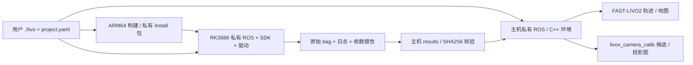

# AVIA + 单目相机平台计划

更新：2026-10-26（Asia/Shanghai）。工程 `/home/eric/grad/实验/livo2` 独立 Git；论文仓库位于 `../../论文`。

## 1. 目的、范围与当前决策

服务于硕士论文的数据采集和单目相对深度研究：**板端稳定录包，主机离线处理**。用户只接触一个 CLI 和一份配置，不需要手工维护 ROS 环境、启动多个终端或拼接 SSH。

- 必需：RK3588 接收相机、AVIA 点云及内置 IMU，记录原始数据；主机一键部署、启动、监控、停止、回传。
- 必需：主机运行 FAST-LIVO2，生成轨迹/地图；主机运行 livox_camera_calib，生成雷达—相机候选外参及投影检查图。
- 保留：板端 LIVO2 构建/回放，供实验室复用。实时 LIVO2 不再是板端采集的验收条件。
- 后续：用有效标定、时间同步及离线几何结果形成深度监督。平台本轮不承诺伪真值质量、网络训练效果或论文创新结论。

AVIA 已于 2026-10-26 在主机接入并完成真实点云/IMU 录包；板端真实雷达收数及相机尚待接入。相机型号、SDK 后续由用户放进 third_party；本轮先完成不依赖硬件的软件工作，不反复追问接线。

用户确认的标定工具是 [livox_camera_calib](https://github.com/hku-mars/livox_camera_calib)，当前接口为图像 + 静态 PCD 的免标定板标定。它需要有效相机内参和合适场景，不等于实时三传感器时空自标定。[LI-Init](https://github.com/hku-mars/LiDAR_IMU_Init) 用于雷达—IMU 外参、时间偏移、重力和偏置初始化；类似 VINS 初始化的角色，但不涉及相机、没有单目尺度恢复问题，本轮不增加此依赖。

## 2. 用户流程与接口

唯一编辑入口是 `project.yaml`，完整字段和默认值以 `project.example.yaml` 为准，内部生成的 YAML/JSON 不要求用户修改。`--config` 只选择另一份完整配置，不另建隐式参数来源。

| 动作 | 命令 | 行为 |
| --- | --- | --- |
| 检查采集端 | `./livo doctor --sensors` | SSH、架构、空间、驱动产物和视频节点信息；节点存在不代表设备可用 |
| 无硬件演练 | `./livo record --replay` | 原始 bag 回放→板端 recorder→结束索引→校验→回传 |
| 正式采集 | `./livo record` | 相机/AVIA 驱动→原始录包→结束→校验→回传；缺相机配置明确失败 |
| 主机处理 | `./livo --host run` | 自动准备主机环境并离线运行 LIVO2 |
| 录包可视化 | `./livo view [bag/目录]` | 本机浏览器三维点云 + 同时间轴图像，不依赖 ROS 或硬件 |
| 主机标定 | `./livo calibrate` | 自动选择主机，输出候选矩阵和投影图，不自动采用 |
| 查看任务 | `./livo status --follow` | 低频摘要及聚合告警，`--raw` 查看原始节点日志 |
| 正常停止 | `./livo stop` | 等待 bag/算法落盘并收取结果 |
| 故障后收取 | `./livo pull [run-id]` | rsync 续传，逐文件 SHA256 校验 |
| 进入环境 | `./livo ssh` | 进入私有 ROS；有活跃任务时连到其 master |
| 手动准备 | `./livo build` / `deploy` | 日常 record/run 已自动处理，无需记住执行顺序 |

主机任务的 build/run/status/stop/pull/ssh 统一加 `--host`。主机与板端各自单任务锁。`calibrate` 总是主机任务，随后查询用 `--host status`。

运行终端 Ctrl-C 请求停止并回传；查看终端 Ctrl-C 只停止查看。SSH 断线后任务继续，重连 status/pull 恢复。没有主机后台服务时，离线期间不承诺自动收取。

## 3. 架构与依赖管理

- Python CLI 用 uv.lock；板端 supervisor 仅需系统 Python 标准库。
- ARM64 构建采用工程私有 GCC/sysroot 和锁定的 Noetic/Focal 依赖。已验证 Ubuntu 22.04 板端原生运行；不携带替换系统 glibc，不改 apt 源、系统 Python 或 bashrc，不要求 Docker。
- 主机 ROS/C++ 采用工程私有 micromamba 前缀 `.cache/host-env`。工具 SHA256 与 405 个环境包的完整 URL/MD5 锁定在 buildkit；与参考 VINS 的环境独立。
- 原始 Livox-SDK 支持 AVIA，不能换成面向其他型号的 SDK2/driver2。SDK 与完整驱动在本工程交叉构建并打包；主机同样从可见源码构建完整 SDK/驱动，支持本地真机雷达收数。
- 所有需查看/debug 的第三方源码在可见的 third_party Git 子模块，固定提交见 dependencies.lock。隐藏目录只放归档、环境、工具链与生成产物。
- 少量平台补丁集中 patches，直接应用到可见源码；不重置人工修改。内容指纹覆盖构建/runtime/patch/上游源码，过期自动重建。
- 主机上游 `-march=native` 与 PCL 预编译包的 Eigen 分配 ABI 冲突，采用统一 x86_64 编译基线，并遵循 PCL 的 C++ 对齐定义；算法数学逻辑不改。
- 相机型号未定，不预装多家 SDK。后续只接入一套实际厂商 ARM64 SDK；闭源 SDK 只锁定二进制与安装步骤，不承诺从源码编译。

板端目录：`~/livo2-workspace/releases/<id>`、`current`、`data/`、`runs/<run-id>/`。安装先校验再切换版本，任务固定真实版本路径，不受新部署影响；板端无需下载源码或联网安装依赖。

主机目录：`.cache/host-env`、`.build/host/install`、`.cache/host-workspace/runs`。原始任务和回传结果分别保存，运行时不直接改写正在核验的结果目录。

## 4. 采集生命周期与数据完整性

1. 验证配置、环境和空间，复用/构建/部署匹配产物。
2. 创建唯一任务和私有 ROS master，先启动旁路观察与 recorder，再启动发布端。
3. 检查图像、CustomMsg、IMU 类型及消息到达；启动超时、时间倒退、持续断流或进程退出时停止。
4. 旁路观察只解析消息头，不解码/修改原始载荷；汇总计数、到达频率、时间范围和序列缺口。
5. 按配置时长结束或接收 stop；停止发布端，再关闭 recorder 写完索引，检查 bag 可读、无 .active、关键流存在。
6. 停止其余节点和 master，生成 summary / files.json，再回传逐文件校验。

默认 30 秒、1 GiB 分包、256 MiB recorder 缓冲；均在 capture 配置。duration_s=null 持续采集。回放演练默认 10 秒，使用仿真时间；真实模式使用设备时间戳。真实采集不默认运行 LIVO2，不启用算法的调频/绑核策略。

保留原始 CustomMsg（逐点时间）、IMU、原始/相机驱动自带压缩图像及额外 CameraInfo。不得为了 LIVO2 的缩放需求改变采集包。CameraInfo 有话题但内参全零时不能当有效标定；驱动时间戳、同步方式、曝光时刻和真实帧率必须上硬件后实测。

旁路收数不等于 recorder 实际接收，也不等于算法处理；序列缺口只做观测，不能自动当成丢包率。正式采集仍需对照 bag 消息数、头时间戳及长时吞吐验证。无硬件演练报告明确 hardware_verified=false。

任务使用进程组与文件锁，只停止自身进程。SIGINT 后有界等待，必要时 SIGKILL，强杀或清理/校验失败都不能伪装成成功 stop。磁盘持续检查，空间不足停止并保留现有文件，不自动删除用户数据。

## 5. LIVO2 与标定生命周期

LIVO2：数据集三路 topic/type 预检→私有 master→解码与算法订阅就绪→回放→按已处理时间排空→正常退出→轨迹/地图/末端覆盖检查→回传。播放结束不代表处理结束；必须有真实视觉更新，不以纯 LIO 代替 LIVO。

数据集按配置话题自动识别 raw / 压缩图像；采集输入 topics.raw_image 与处理输出 topics.image 分开。图像在解码器统一缩放、完整五参数去畸变，下游内参随输出尺寸调整。板端可临时设置 A76 核与 performance 调频，结束/stop/受控异常恢复；主机及纯采集不修改 governor。

标定：用户给原始图像、对应静态场景 PCD 和内参→生成全部参数→无界面执行上游标定→矩阵有限值、SO(3)、齐次结构及投影文件检查→保存候选。输出方向 T_camera_lidar；不自动写回 project.yaml。真实采用前需检查不同距离/视角投影、重复结果和时间关系；软件收敛不代表精度合格。

示例数据约 173.75 秒，AVIA 点云 1737、IMU 35425、压缩图像 2582；CameraInfo 内参全零。示例内外参来自已有 R3LIVE 配置及方向核对，未验证精度。无真值时不报告 ATE/RPE 或深度误差。

## 6. 固定规则的监控

独立 runtime/monitor.py 增量读取本任务 logs/（含 ROS、驱动、recorder、supervisor）及算法 Log/，跟踪新增文件、截断和持久化游标，不使用大模型读日志。

- 常规输出按 monitoring.refresh_s 给阶段、时长、处理/视觉更新数，或三路收数/频率摘要，不输出每帧日志。
- 优先解析日志自身级别，再识别无级别异常/崩溃。INFO 中出现环境变量文本 ERROR 不误报；未知 WARN/ERROR 保留。
- 首次告警提示，重复项按签名聚合、保留累计次数和代表原文；限频不删除原始日志。
- 可靠匹配的跨源副本去重；格式无法可靠匹配时明确按日志记录计数，不能声称全局事件去重。
- 多行 Python 异常保留根因与上下文；监控自身退出、心跳过期、算法处理停滞明确失败。
- ROS 的退出 XMLRPC 错误保持可见，任务结果综合退出状态、文件及覆盖检查，不把所有 ERROR 自动等同失败。

完整原始日志、事件源和偏移保留在 results。重连会展示当前重要告警，不假称具有跨 CLI 会话的已读状态。

## 7. 结果与验收

| 文件 | 用途 |
| --- | --- |
| summary.json / state.json | 阶段、结果、失败原因、节点退出码、耗时与资源 |
| config.resolved.yaml、生成配置 | 本次实际参数 |
| capture-state.json / capture-report.json | 旁路三路观测与已写 bag 的计数/类型、演练边界 |
| data/*.bag | 原始录包，可分块 |
| algorithm/Log/result、pcd | LIVO2 轨迹与分块地图 |
| extrinsic.txt、投影 PNG、calibration-report.json | 标定候选和未验证精度标记 |
| logs/、monitor/events.jsonl | 完整原始日志与固定规则事件 |
| files.json、transfer.json | 逐文件 SHA256 与主机核验收据 |

软件阶段验证证据汇总在 evidence/software/README.md；大 bag、日志和环境不提交 Git。板端包 provenance.json 保存源码/补丁/依赖信息；主机 install/build.json 保存源码内容指纹和环境锁哈希。

| 阶段 | 验收条件 | 状态 |
| --- | --- | --- |
| M0 远控闭环 | 私有环境、断线查询、正常停止、版本隔离、校验回传 | 已通过 v0.1.0 |
| M1 板端回放 | 短跑 + 完整三路序列、视觉参与、末段覆盖、轨迹/地图 | 已通过 v0.1.0；v0.1.1 性能调优 |
| M2 软件采集与主机工具 | SDK/驱动源码构建；无硬件录包演练；主机完整 LIVO2；标定软件 smoke；失败退出 | 已通过软件验收，v0.2.0-rc1；硬件待验 |
| M3 真实硬件采集 | 相机 SDK 接入、AVIA 收数、时间/曝光核查、长时录包与掉线测试 | 等硬件和相机 SDK |
| M4 几何监督可用 | 有效内参/外参/同步、真实录包离线重建、深度投影/遮挡与质量验证 | M3 后推进 |

硬件到位后的顺序：单设备收数→三路联合短录→停止/断线/空间故障→至少一条长录完整回传→主机重放→真实标定与投影检查。接线不在本轮范围，不以 SDK 编译代替真实传感器验收。

## 8. 已完成里程碑与边界

- 2026-10-23，v0.1.0：板端完整回放约 528.26 秒，2575 位姿/视觉更新、27 PCD、末段差 0.0928 秒，退出及自动回传通过。独立安装、并发锁、停止/重复停止与断线恢复见 [初版证据](evidence/README.md)。
- 2026-10-23，v0.1.1：同一输入约 250.45 秒，输出覆盖同量级，约 2.11 倍加速；仍需排空，不宣称 15 Hz 实时。调频恢复与受控失败见 [性能证据](evidence/performance/README.md)。
- 2026-10-23 至 24：按用户决定转向板端采集，新增官方 Livox-SDK 和 livox_camera_calib 可见子模块；扩展共享 supervisor，实现 record、主机 run 与 calibrate，不建设另一套远控平台。
- 软件版使用 annotated 候选 tag，硬件未验收不发布为真实采集完成。旧失败和修复证据保留；不把程序启动、优化收敛或文件非空当作完整结论。

- 2026-10-24，v0.2.0-rc1：SDK/驱动交叉构建、压缩/raw 板端录包演练与载荷一致性、主动/重复停止、无输入失败退出、主机完整 LIVO2（180.45 秒）和标定软件 smoke 通过。相机 SDK、真实收数/同步与精度待硬件阶段；详见 [软件验收证据](evidence/software/README.md)。

- 2026-10-26，v0.2.0-rc2：主机 AVIA 真机接入（192.168.1.189），修复 UFW 阻断发现广播；新增 ./livo --host lidar 和后台模式，30 秒录包/正常退出/回传校验及点云原始结构检查通过。点云约 10 Hz、IMU 约 204 Hz；设备头时间为启动后时间，相机同步与标定仍待验收。见 [真机证据](evidence/avia-host/README.md)。

- 2026-10-26，v0.2.0-rc3：增加工程内离线三维录包播放器 `viewer/`，用 `./livo view` 打开最近录包；共享时间轴、逐帧/倍速/拖动、三维交互与图像预留。实录 AVIA 全部 304 帧检查通过，已有 JPEG 录包与合成 raw 图像包验证通过；损坏图像不阻断点云。按 bag 记录时间显示，不作为硬件同步或标定验收。见 [回放验收](evidence/viewer/README.md)。
