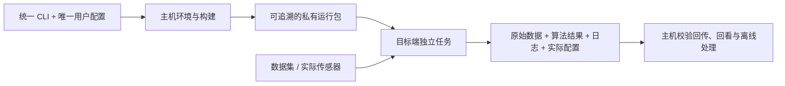

# 算法与传感器部署的单入口工程范式

目标是让新接手的用户用少量命令完成一次实验，不必先学习 ROS、SDK、交叉编译和远控的内部组合。把复杂性收进工程，优先复用已有能力，用最少的适配代码完成当轮可验收的闭环。

以下沿用 `./livo` 和 `project.yaml` 举例；迁移到其他项目时可换名字。算法、传感器、处理器、操作系统及构建工具由实际需求决定。

## 四个核心设计

- **一个入口。** 例如做的是fast livo项目。`./livo` 是统一的操作界面。`run` 根据任务自动检查环境、复用或构建产物、部署、准备数据、运行、保存及回传。手动构建、部署和调试入口按需开放，日常使用不要求用户记住准备步骤的执行顺序。
- **一份配置。** `project.yaml` 是用户参数的唯一来源：目标设备与 SSH、路径、数据集、传感器、标定与时间偏移、算法参数、录包和回传策略都在这里维护。工具生成上游所需的 YAML、JSON 或启动参数；不让用户在多份配置中重复修改同一信息。
- **主机构建、板端运行。** 主机用 uv 或等效工具管理 CLI 环境，用隔离构建器管理 ROS/C++、工具链和目标架构依赖。主机构建可用源码、交叉编译板端组件，组合私有运行包；板端保留现有系统，解包即可运行。闭源 SDK 使用对应架构的厂商产物。需要在主机处理的算法同样有独立、可复现的环境。
- **回放与采集共享流程。** 数据集模式从已有数据输入；硬件模式接入 SDK、驱动并增加原始录包。两者复用任务管理、监控、停止、产物整理和回传，结束后把算法结果、日志及本次录制的原始数据带回主机。

## 按职责划分，而非按设备复制工程

用户界面负责表达“要做什么”，公共任务层负责“如何可靠完成”，算法与传感器适配层负责连接具体上游。新增组件尽量只增加构建、参数映射、启动和结果检查的适配，沿用既有闭环。

采集和算法处理可以部署在不同位置。板端只承担任务需要且资源允许的工作；原始数据回主机处理也是完整方案，不把所有算法移植上板当成默认目标。

第三方源码、驱动及 SDK 放在可见的 `third_party/`，方便人工阅读和调试，锁定来源与版本。缓存、构建目录和打包产物与源码分开。补丁保持集中、少量、可追踪；构建复用要能识别源码和依赖的实际变化。

## 让一次任务成为完整的交付单位

每次运行有独立身份，关联实际配置、使用的运行包、原始日志和输出。构建与部署可重入，匹配的产物可以复用；新部署不应改变正在运行任务所用的版本。

后台任务在目标端独立管理。SSH 或主机断线不影响采集；重连后可以查询、正常停止和补收。停止应完成文件落盘并清理本任务拥有的进程，传输应能续传并核验完整性。

用户看到的是阶段、频率、进度和重要告警，而非持续滚屏的原始日志。用固定规则的程序提取摘要、聚合 WARN/ERROR，并保留原文。区分“观察到数据”“实际写入数据”和“算法处理完成”，也区分设备断流与监控自身失效。

原始采集尽量忠实保留数据及时间信息；算法需要的缩放、去畸变等处理作为明确的下游步骤。输出应让人知道用了什么参数、得到什么结果、哪里失败，以及哪些结论尚未验证。

## 推进和验收方式

先明确本轮目的、范围、最短用户操作路径及成功标准，再选择实现方式。用户要求先看设计时，先交付设计；已授权实现时按该范围推进。

优先打通一个代表性的完整流程，再沿同一范式扩展。少量辅助命令可以覆盖检查、状态、停止、补收、回看和进入环境；命令集合按需要裁剪，不把示例接口变成强制模板。

验收沿用户实际路径完成：输入可用 → 目标端真实收数或处理 → 正常结束 → 文件可读 → 回传完整 → 主机能检查或回看。分清软件演练、真实硬件运行、同步与标定质量，不用前一阶段的成功替代后一阶段的证据。

源码、依赖锁和设计文档用 Git 追踪，运行数据和生成环境单独管理；在可复现、已验收的节点提交并按需要打 tag。具体目录、协议、部署机制和适配细节随项目选择，保持上述用户体验和运行闭环即可。
